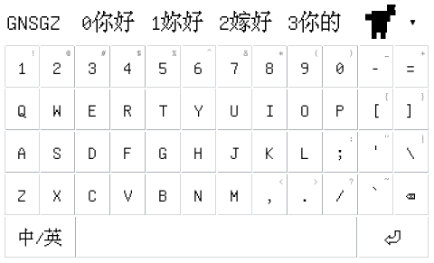
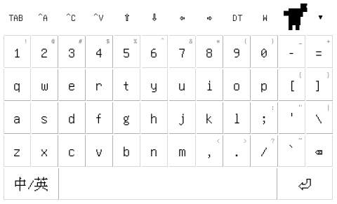
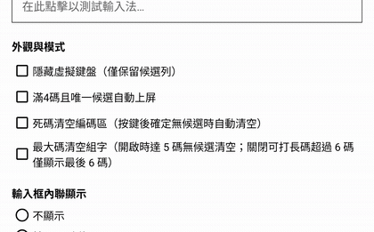

# 🦐 小蝦米輸入法 mrubyime-kivy

> 一支用 **mruby** 寫引擎、用 **Kivy** 畫鍵盤的 Android `.cin` 形碼輸入法。
> 碼表可換、鍵盤可改、改一行 Python 只要 **2 秒**就能裝回手機。

<p align="center">
  
</p>

<p align="center">
  <b>打 <code>gnsgz</code> → 你好 妳好</b><br>
  <sub>編碼區在左、候選字在中、收鍵盤在右，12 欄格線、沒有一條多餘的線。</sub>
</p>

---

## 這是什麼

一個 Android 輸入法。引擎不是 Java 寫的規則表，是**真正的 mruby 直譯器**跑在手機上：

- 你給它一份 `.cin` 碼表，它就照那份表打。嘸蝦米、注音、倉頡、大易、行列、五筆、拼音……
  內建沒有任何「某家輸入法」的硬編碼規則。
- 換字型、換顏色、加鍵、改手勢，都是改 `keyboard.py` 一個檔案，2 秒後手機上就看到了。

```
輸入法服務 (Kotlin)  ──TCP JSON──  鍵盤畫面 (Python/Kivy)
   mruby 引擎                       12 欄 × 5 列
   解析 .cin、算候選字              手勢、音效、小恐龍
```

---

## 長什麼樣

### 中文：打字與選字

<p align="center">
  
</p>

左邊長條是**編碼區**（你打的字根），中間是**候選字**，每個候選字前面標著它的選字鍵。
打超過 6 碼時編碼區只顯示最後 6 碼——正在打的永遠在尾端。點編碼區可以直接把那串碼送出去。

### 英文：換一套鍵盤，不是換一個狀態

<p align="center">
  
</p>

英文模式不是把中文鍵盤灰色化，是**真的換一列**：字母變小寫，上面的編碼區＋候選字
整排換成 `TAB`、`^A ^C ^V`（剪貼簿）、`⇧ ⇩ ⇦ ⇨`（方向鍵）、`DT`（日期時間）、`W`（星期）。

### 不自量力的飯後娛樂

<p align="center">
  
</p>

打字打累了，候選列右邊點那隻小恐龍：整片鍵盤變成 T-Rex Runner。
**點一下跳、往下滑蹲**，躲仙人掌和飛鳥istica Cayenne。`KB` 鍵隨時回到打字。

---

## 為什麼要讓人看得見它怎麼做的

一般 Android 輸入法，改一個按鍵的圓角 → 改 XML → 重編 Kotlin → 打 APK → 安裝 → 重開
輸入法 → 看成。一輪三分鐘，改十輪就半小時，於是你最後會習慣那個不順眼的圓角。

這裡的 UI 是 Python。被打包成一個 `private.tar` 放進 assets，執行時解到 files。
所以改一行 `keyboard.py`：

```bash
cd mruby-ime && ./sync_python.sh
```

**2 秒。** 沒在誇張，這是實測：重新編 `.pyc`、重打包 tar、Gradle 增量、`adb install -r`。

改的是這個：

```python
# mruby-ime/app/src/main/python/kivy_ime/keyboard.py都不要
ROW_5 = [
    {"label": "中/英", "action": "toggle_mode", "span": 2},
    {"label": "",      "action": "space",       "span": 8},
    {"label": "\u23ce", "action": "enter",       "span": 2},
]
```

引擎不用重編、mruby 不用碰、Kotlin 不用動。

---

## 碼表：放進去就會動

內建是 **uniliu 萬國蝦米**（30,478 碼 / 47,788 字 + 139,637 詞）。

要換成自己的：

```bash
# 方式一：丟進 assets/dicts/，重新編 APK，設定頁就會出現
cp 我的碼表.cin mruby-ime/app/src/main/assets/dicts/

# 方式二：不用編譯，App 裡直接匯入
#   設定 → 輸入法碼表 (.cin) → 匯入 → 選檔案
```

支援 `%ename` `%cname` `%selkey` `%keyname` `%chardef` `%phrase`。
`%phrase` 可以寫權重（`你好 121`），候選字會照詞頻排序；
一字的詞一律忽略，所以單字的順序永遠跟你碼表裡寫的一樣。

輸入法會自動從你的碼表推論這三件事，不需要你設定：

| 它自己看 | 怎麼用 |
|---|---|
| 哪些鍵是字根 | `%keyname` 的鍵 ∪ 碼表裡所有出現過的字元 |
| 第一個候選字是第幾鍵 | `%selkey`；寫 `0123456789` 就是 `0`，寫 `1234567890` 就是 `1` |
| 最長打幾碼 | 碼表裡最長的碼。超過就不再去查候選，避免無用的搜尋 |

---

## 一些刻意的選擇

**為什麼鍵與鍵之間沒有縫隙。**
底圖是白（或深色），鍵也是白，靠的是每邊 1 dp 的黑線畫出格線。
兩個相鄰的鍵共用同一條線 → 看起來永遠是 1 dp，不會變成 2 dp 的粗黑邊。

**為什麼編碼區不換行。**
換行的編碼區會在你打第 5 碼時突然長高，把整排候選字往上推。
所以它固定一行、往左裁掉，永遠只顯示正在打的尾端。

**為什麼候選字 chip 都一樣寬。**
選字提示（`0` `1` `2`）如果在選取時才出現，每選一個字整排 chip 就左右跳一次。
所以寬度用最寬的 `0微` 算好，選取提示只換顏色不換寬度。

**為什麼收鍵盤一定要清掉組字。**
不然你打了一半的 `aad`（情形），按 `▼` 收鍵盤、切到別的 App，
再回來，`aad` 還躺在輸入框裡，而且沒有鍵盤可以救它。

**為什麼 Alt+Space 和 Shift+Space，而不是單按 Shift。**
單按 Shift 是打大寫。把它當切換鍵，你就再也不能打一個大寫的 A。

**為什麼是 arm64 而已。**
JNI 的 libmruby 只編了 `arm64-v8a`。x86_64 模擬器載不起來，裝了會壞在啟動。

---

## 建置

需要 **JDK 17**、**NDK 30.0.16248370**、**Ruby**（mruby 與鍵盤 DSL 都在 build 時才需要）。

```bash
cd mruby-ime

# 只改 Python（鍵盤畫面）→ 2 秒
./sync_python.sh

# 改了 .rb（引擎／碼表／DSL）或第一次編 → ~1 分鐘，會編 mruby、重跑專案、裝到手機
./build_all.sh

# 只要 APK，不碰手機
JAVA_HOME=/opt/android-studio/jbr ./gradlew assembleRelease
# → app/build/outputs/apk/release/app-release.apk（約 22 MB）
```

> ⚠️ **改了 `.rb` 一定要重跑 `build_mruby.sh`。** 執行時讀的是編譯好的 C 陣列
> （`engine_irep.c` 等），不是 `.rb` 檔。改了 `.rb` 卻只跑 `sync_python.sh`，
> 手機上不會有任何變化——這是這個專案最大的陷阱。

不接手機也能建：

```bash
gh workflow run build-apk.yml          # 或直接 push
```

APK 會出現在該次 run 的 **`mrubyime-kivy-apk`** artifact；
推 `v*` tag 或 push `main` 時也會同步更新 Release 的 `mrubyime-kivy.apk`。

---

## 文件導覽

| 檔案 | 內容 |
|---|---|
| **[README_KIVY.md](README_KIVY.md)** | ★ 現行鍵盤：架構、版面、手勢、顏色、字型、除錯 |
| [mruby-ime/README.md](mruby-ime/README.md) | 完整使用者說明。**第 2 節之後的 Ruby DSL 版面章節已失效**，見該檔開頭標記 |
| [mruby-ime/SKILL.md](mruby-ime/SKILL.md) | mruby／JNI／UTF-8 的實作規定。改引擎或 bridge 前必讀 |
| [mruby-ime/KIVY_BUILD.md](mruby-ime/KIVY_BUILD.md) | p4a 建置細節、patch、CI |
| [mruby-ime/KIVY_KEYBOARD.md](mruby-ime/KIVY_KEYBOARD.md) | 鍵盤調整筆記 |
| [AGENTS.md](AGENTS.md) | 給 AI 協作者看的專案事實與陷阱 |
| [mruby-ime/docs/ENGINE_CAPABILITIES.md](mruby-ime/docs/ENGINE_CAPABILITIES.md) | 引擎能做到什麼、不能做到什麼 |
| [mruby-ime/docs/PHRASE_TEACHING.md](mruby-ime/docs/PHRASE_TEACHING.md) | 詞組／自動組詞的行為 |
| [mruby-ime/docs/LAYOUT_DSL.md](mruby-ime/docs/LAYOUT_DSL.md) | 舊的 Ruby 版面 DSL。**已失效，僅供對照** |

---

## 狀態

- **現行**：Python/Kivy 前端 ＋ mruby `.cin` 引擎，`arm64-v8a`。
- **已移除**：Ruby DSL 自訂鍵盤畫面、使用者自訂引擎（APK 瘦身）。
- **開發中**：小恐龍遊戲模式（見上方 GIF）。玩得起來，但碰撞判定與螢幕底部安全區
  還在調整，偶爾會提早結束或被打字列的導航鍵蓋住。

---

## 授權

輸入法引擎、鍵盤、字型來源與各自的授權請參考各目錄內說明。
內建碼表（uniliu 萬國蝦米）的授權請以原始發布者為準。
